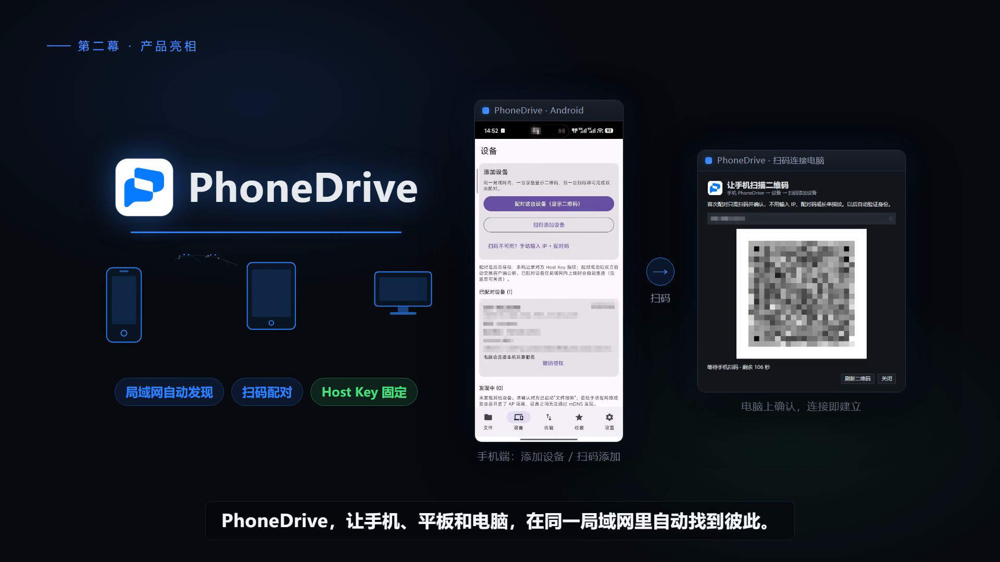
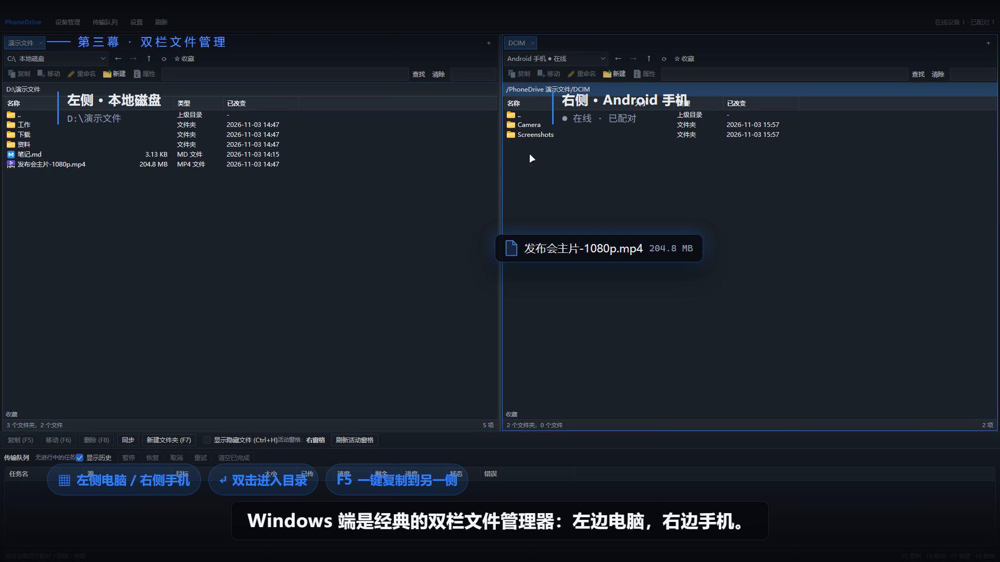
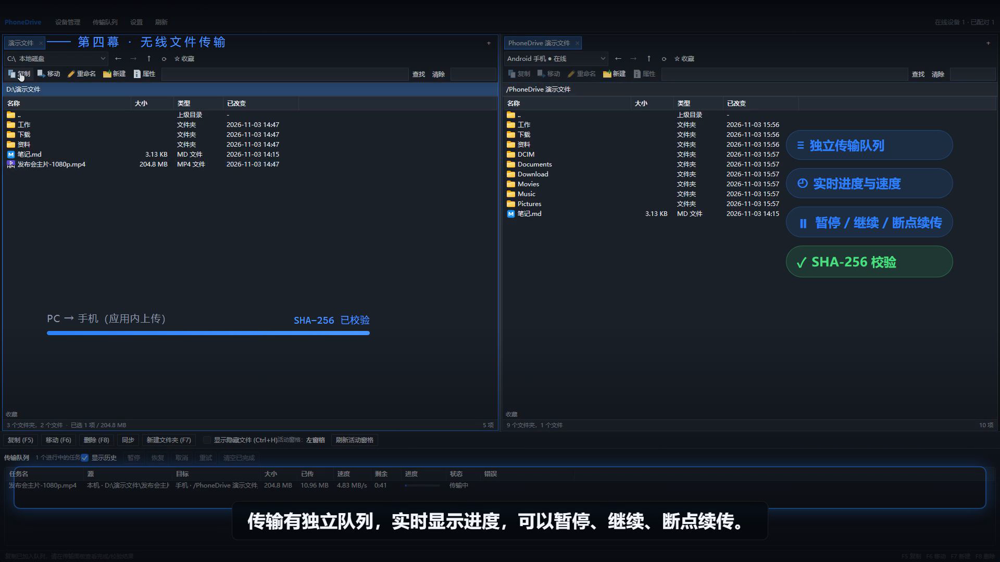
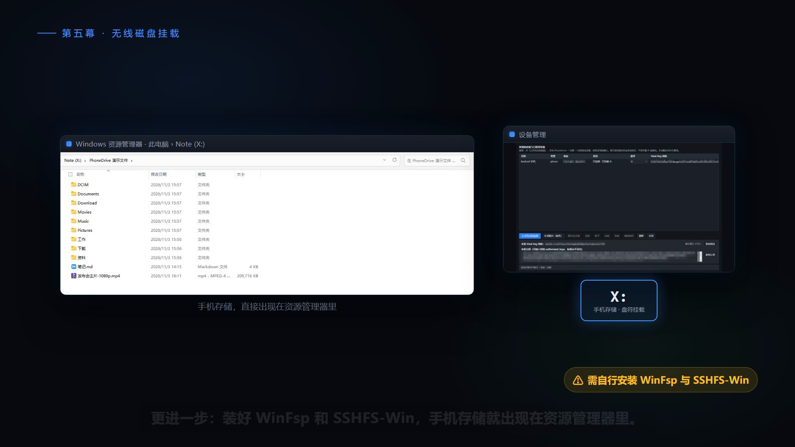

# PhoneDrive


Android 手机、平板与 Windows 电脑之间的局域网文件管理、传输和磁盘挂载工具。当前正式版本：**0.2.7**。

[下载正式版](https://github.com/palyer313/PhoneDrive/releases/tag/v0.2.7) · [更新说明与验证范围](docs/release-0.2.7.md)



界面图截取自用户提供的演示视频，画面为较早的预览版；当前下载版本为正式版 0.2.7。[截图来源说明](docs/media/README.md)

0.2.7 新增手机共享文件夹浏览与新建、系统分享文件/相册图片到已配对电脑、首次接收保存位置选择，以及两端预设主题色、自定义颜色盘和夜间模式；修复 Windows 重复启动异常，再次启动直接打开已有主窗口。

本版保留 0.2.5 的应用内上传流水线与空闲唤醒优化。此前 Note11 前台亮屏条件下，同一 1 GiB 随机文件连续三轮上传约 **36 MiB/s**，包含两次完整读回校验的全流程为 **11.79–12.08 MiB/s**；这是 0.2.5 的测试结果，本轮没有重复性能长测。资源管理器挂载盘符使用独立的 SSHFS-Win 路径，尚未完成同等长测验收，不能套用上述结果。

## 功能

- Windows 双栏文件管理器，使用 Windows Shell 文件类型图标；重复启动自动唤起已有窗口。
- Android 共享范围支持浏览选择目录，并在当前目录新建文件夹。
- 文件管理器、相册通过系统“分享 → PhoneDrive”发送单个或多个文件/图片到已配对电脑。
- 电脑首次接收分享时选择保存位置，默认使用系统下载目录；可在设置中更改，同名文件自动追加编号。
- Windows 与 Android 均支持跟随系统、浅色、夜间模式；提供五种预设主题色及颜色盘、自定义颜色值，设置自动记忆。
- Android SFTP 共享服务、局域网设备发现、二维码配对和固定 Host Key 校验。
- 文件传输队列、断点续传及 SHA-256 校验。
- 首次本地→SFTP 上传采用有界流水线，保留固定 Host Key、临时文件、源文件复核与安全提交。
- 通过独立安装的 WinFsp 和 SSHFS-Win 将手机存储挂载成 Windows 盘符。
- Android 开机启动开关、熄屏共享设置、系统文件选择器集成。



<details>
<summary>查看更多界面图：传输队列与盘符挂载</summary>





</details>

## 安装与使用

从 Releases 下载 Windows 安装程序或 Android APK。Windows 安装程序面向当前用户，创建开始菜单入口和可选桌面快捷方式。

磁盘挂载需要另外安装 [WinFsp](https://github.com/winfsp/winfsp/releases) 和 [SSHFS-Win](https://github.com/winfsp/sshfs-win/releases)。这些驱动不随本项目分发。

手机授予存储访问权限并启动共享服务。电脑打开设备管理中的扫码连接入口，手机扫描电脑二维码，在电脑确认后完成配对。

分享文件：双方升级到 0.2.7，电脑保持运行并连接手机；在手机文件管理器或相册选择文件 → 分享 → PhoneDrive → 选择已配对电脑 → 发送。首次接收时在电脑选择系统下载目录或其他文件夹，之后在“设置 → 手机分享接收文件夹”修改。关闭自动连接时需先手动连接手机。手机原文件保持不变，接收进度与重试可在电脑传输队列查看。

主题与夜间模式：两端进入设置，选择“跟随系统 / 浅色 / 夜间模式”，再选择海蓝、翡翠、紫罗兰、玫瑰、琥珀或使用颜色盘。共享目录在手机“设置 → 共享范围与权限”选择，保存后重启手机文件服务生效。

Android 后台、自启动和熄屏运行受系统限制。开机启动和“服务被系统结束后自动恢复”为独立选项，自动恢复默认关闭；传输唤醒锁由真实文件读写触发，空闲后释放。长时间后台或熄屏可靠性仍需按设备验证；本轮性能测试没有要求开启自启动或电池无限制。强制停止应用后需要手动重新打开。

## 构建

Windows 需要 .NET 8 SDK；Android 需要 JDK 17 和 Android SDK 34。设置本机 JAVA_HOME、ANDROID_HOME，或通过 local.properties 指定 SDK 路径。

```powershell
dotnet restore windows/PhoneDrive-Windows/PhoneDrive.sln
dotnet build windows/PhoneDrive-Windows/PhoneDrive.sln -c Release
dotnet test windows/PhoneDrive-Windows/PhoneDrive.sln -c Release
cd android/PhoneDrive-Android
.\gradlew.bat assembleDebug testDebugUnitTest
```

Android release 签名由开发者自己的 keystore.properties 配置；私钥和密码不在仓库中。自行签名的版本通常不能覆盖官方签名版本。

Windows 安装器源码位于 installer/PhoneDrive.iss，需要 Inno Setup 6，可用 `/DBuildVersion=版本号` 指定安装包版本。公开版本不包含本机配置、配对记录或调试符号。

## 状态与验证边界

Windows 与 Android 发布构建通过；Core 48 项、Android 15 项单元测试，以及 10 项分享接收检查通过，包含实际认证与固定 Host Key 的 SFTP 回环接收、哈希校验、重名保护和重启去重。Windows 重复启动、颜色盘、预设主题保存及夜间模式恢复已进行真实界面检查。

本轮尚未覆盖日用 Windows 安装，也未在真实手机覆盖安装后完成相册分享、目录选择及选色手势的完整验收；首次接收位置弹窗的人工选择流程仍待验证。系统原生对话框遵循 Windows 外观。详见[本版验证范围](docs/release-0.2.7.md)。

## 作者与开发协作

- **项目发起者与维护者：** [palyer313](https://github.com/palyer313)，负责项目方向、需求、设计取舍与实际使用反馈。
- **AI 开发协作：** OpenAI Codex，参与代码审查与修复、界面与图标设计、测试、安装包制作及发布准备。
- **演示截图：** 从用户提供的 MiniMax M3.1-Flash 演示视频中截取，见[素材说明](docs/media/README.md)。

## 参考项目与致谢

感谢以下开源项目及其作者。下表按实际用途说明参考关系；具体版权与许可证声明见 [NOTICE.md](NOTICE.md) 和 [third_party/](third_party/)。

### 界面布局改编

[WinSCP](https://github.com/winscp/winscp) 是 Windows 双栏 Commander 界面的主要来源。PhoneDrive 依据其 [ScpCommander.dfm](https://github.com/winscp/winscp/blob/master/source/forms/ScpCommander.dfm) 的面板、工具栏、路径栏、文件列表及状态栏结构，使用 WPF 重新实现并接入自身服务。原始资源与许可证保存在 [third_party/references/winscp/](third_party/references/winscp/)，对应关系见 [布局移植说明](docs/winscp-layout-port.md)。

### 方案研究与设计参考

以下项目在前期方案研究中提供了参考；列入此处不表示直接依赖或复制其代码。

| 项目 | 参考内容 |
| --- | --- |
| [Primitive FTPd](https://github.com/wolpi/prim-ftpd) | Android 文件共享、存储访问适配、SFTP 服务与公钥认证方案。 |
| [Sshd4a](https://github.com/tfonteyn/Sshd4a) | Android SSH/SFTP 服务及后台服务的产品形态。 |
| [sshfs-win-tray](https://github.com/huangzhenming/sshfs-win-tray) | Windows SSHFS 挂载管理、托盘交互与便携配置思路。 |
| [LocalSend](https://github.com/localsend/localsend) | 局域网设备发现、跨设备文件传输及低配置连接体验。 |
| [KDE Connect](https://github.com/KDE/kdeconnect-android) | 跨设备协作、配对确认与设备信任流程。 |

### 挂载组件与主要依赖

| 项目 | 在 PhoneDrive 中的用途 |
| --- | --- |
| [WinFsp](https://github.com/winfsp/winfsp) | Windows 文件系统挂载基础，由用户独立安装。 |
| [SSHFS-Win](https://github.com/winfsp/sshfs-win) | 以独立进程把远端 SFTP 存储挂载为 Windows 盘符，由用户独立安装。 |
| [Apache MINA SSHD](https://github.com/apache/mina-sshd) | Android SFTP 服务端与客户端。 |
| [SSH.NET](https://github.com/sshnet/SSH.NET) | Windows SFTP 连接与文件操作。 |
| [Tmds.MDns](https://github.com/tmds/Tmds.MDns) | Windows 局域网 mDNS 设备发现。 |
| [QRCoder](https://github.com/codebude/QRCoder) | Windows 配对二维码生成。 |
| [ZXing](https://github.com/zxing/zxing) / [ZXing Android Embedded](https://github.com/journeyapps/zxing-android-embedded) | Android 二维码生成与扫描。 |
| [Android Jetpack Compose](https://developer.android.com/compose) | Android 应用界面。 |

## 许可证

本项目按 GPL-3.0 发布，见 LICENSE。Windows Commander 布局改编自 WinSCP 的 ScpCommander.dfm；版权及第三方声明见 NOTICE.md 和 third_party/。第三方依赖保留各自许可证。
